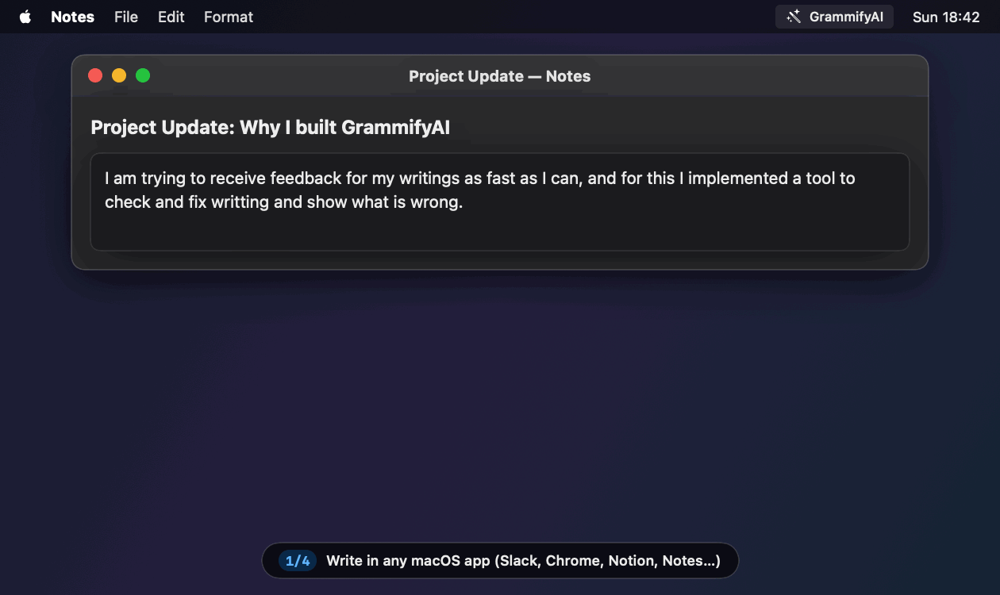
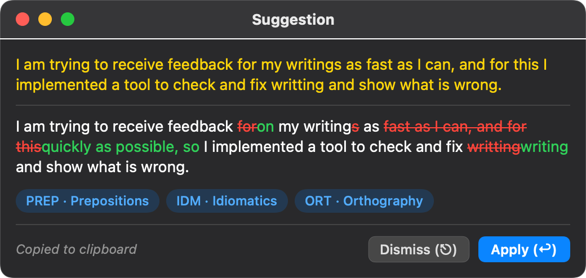
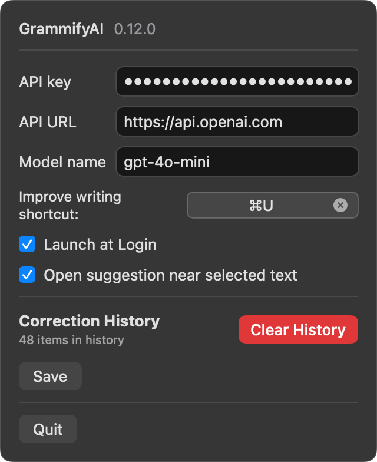
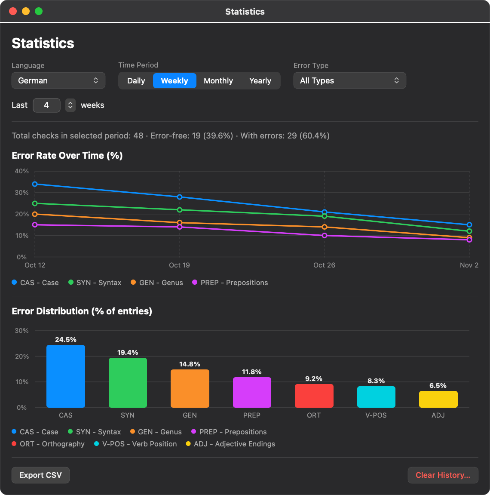

# GrammifyAI

[](https://github.com/harentius/GrammifyAI/releases)
[](https://github.com/harentius/GrammifyAI/releases)
[](https://github.com/harentius/GrammifyAI/releases)
[](LICENSE)

**Minimalist, native macOS menu bar grammar checker and writing assistant that works in any app, any language, and with any OpenAI-compatible or local LLM.**

Select text anywhere on macOS, press `⌘ + U`, review the word-level diff and categorized grammar mistakes in a floating popup, and press `↩` (Enter) to replace the text directly in your active app.

<p align="center">
  
</p>

GrammifyAI uses **your own LLM API key** (or a local model via **Ollama** / **LM Studio**). There are no subscriptions, quotas, or middleman servers—your text goes directly from your Mac to your chosen LLM endpoint.

---

## Why GrammifyAI?

| Capability | GrammifyAI | Grammarly / SaaS Tools | ChatGPT / Web UI |
| :--- | :--- | :--- | :--- |
| **System-wide workflow** | `⌘ + U` → `↩` replaces text in-place | Browser extension / heavy desktop agent | Manual copy, switch window, paste |
| **Visual word-level diff** | Color-coded additions & deletions before applying | Single-error underlines or blind rewrite | Plain text output without diff |
| **Error category analytics** | Tracks recurring grammar blind spots over time + CSV export | Basic weekly email summaries | None |
| **Multilingual & language learning** | Any language + dedicated **German** & **English** grammar categories | Primarily English-focused | Manual prompting required |
| **Pricing & privacy** | **Free & Open Source** (BYOK or 100% offline with Ollama) | \$12–\$30/month subscription | \$20/month or cloud-only |

---

## Features

* **System-Wide Shortcut:** Trigger corrections in any native or web app with `⌘ + U` (customizable in Settings).
* **Word-Level Visual Diff & Error Badges:** Inspect exact additions (green) and deletions (red strikethrough) alongside classified error badges (hover any badge to see the exact `"original" → "corrected"` fragment).
* **One-Key Direct Replace (`↩`):** Press `↩` (Enter) in the suggestion popup to immediately replace the selected text in the source application, or `⎋` (Escape) to dismiss. Suggestions are also automatically copied to your clipboard.
* **Floating Popup Near Selection:** Optionally anchor a compact, auto-sized suggestion popup right next to your selected text.
* **Writing Statistics & Error Classification:** Automatically detects the language of your text, classifies mistakes into universal and language-specific grammar categories, and charts your error rate trends over time.
* **Any OpenAI-Compatible or Local LLM:** Defaults to OpenAI (`gpt-4o-mini`), or point it to **Ollama**, **LM Studio**, **Groq**, **OpenRouter**, or any OpenAI-compatible endpoint.
* **Native Menu Bar App:** Built with SwiftUI, supports **Launch at Login**, and includes built-in updates via **Check for Updates...** (Sparkle).

<p align="center">
  
  &nbsp;&nbsp;
  
</p>

---

## Writing Statistics & Language Learning Analytics

Unlike tools that silently fix your typos without helping you improve, GrammifyAI records your mistake categories locally so you can spot and eliminate recurring grammar habits over time:

* **Universal Categories:** `SYN` (Syntax), `VOC` (Vocabulary), `PREP` (Prepositions), `IDM` (Idiomatics), `REG` (Register), `ORT` (Orthography)
* **German-Specific Categories:** `CAS` (Case: Dativ/Akkusativ/Genitiv), `GEN` (Genus: der/die/das), `V-POS` (Verb Position: V2 vs. subordinate clause), `ADJ` (Adjective Endings)
* **English-Specific Categories:** `ART` (Articles: a/an/the), `TNS` (Tenses), `ASP` (Aspect: simple vs. progressive)

Filter your error rates by language, time period (Daily, Weekly, Monthly, Yearly), or specific error type, and export your full correction history to **CSV** for custom review or flashcards.

<p align="center">
  
</p>

---

## Supported LLM Providers

You can use any OpenAI-compatible `/chat/completions` endpoint in **Settings**:

| Provider | API URL | Example Model Name | Notes |
| :--- | :--- | :--- | :--- |
| **OpenAI** *(Default)* | `https://api.openai.com` | `gpt-4o-mini` | Fast, accurate, fractions of a cent per day |
| **Ollama** *(Local / Offline)* | `http://localhost:11434/v1` | `llama3.1:8b` / `qwen2.5:14b` | 100% private & free on Apple Silicon |
| **LM Studio** *(Local)* | `http://localhost:1234/v1` | `local-model` | Run any local GGUF/MLX model |
| **Groq** | `https://api.groq.com/openai` | `llama-3.3-70b-versatile` | Near-instant inference |
| **OpenRouter** | `https://openrouter.ai/api` | `anthropic/claude-3.5-haiku` | Access 100+ models with one key |

---

## Installation

> **Requirements:** macOS 14.5 (Sonoma) or later.

1.  Download the latest [release](https://github.com/harentius/GrammifyAI/releases) and move **GrammifyAI.app** to your **Applications** folder.
2.  Right-click the GrammifyAI app and select **Open** to bypass the initial Gatekeeper check. Grant permission to open it if prompted.
    * *Note:* If the app is blocked, go to **System Settings > Privacy & Security** and allow the app to open.
      
3.  **Grant Accessibility permissions:** On first launch, macOS will automatically prompt you to grant Accessibility access. Click **Open System Settings** in the prompt (or use the **Grant Permission** button in the menu bar popover) and toggle **GrammifyAI** on in **System Settings > Privacy & Security > Accessibility**.  
    
4.  Open **Settings** in the GrammifyAI menu bar popover:
    * Enter your **API key**.
    * *(Optional)* Customize the **API URL** (default: `https://api.openai.com`), **Model name** (default: `gpt-4o-mini`), keyboard shortcut, **Launch at Login**, or **Open suggestion near selected text**.

## Updating the App

1.  Click the GrammifyAI menu bar icon and select **Check for Updates...** to install updates in-app, or download the latest release manually from GitHub.
2.  GrammifyAI signs releases with a persistent certificate so your macOS Accessibility permission is preserved across updates. If macOS ever requires re-authorization after a manual install, GrammifyAI automatically resets the stale entry and prompts you to toggle it back on.

---

## Usage

1.  Select the text you want to improve in any application.
2.  Press `⌘ + U` (or your custom shortcut).
3.  Review the suggested correction and error category badges in the diff view.
4.  Press `↩` (Enter) to replace the selected text directly in the source app, or press `⎋` (Escape) to dismiss (the suggestion is also copied to your clipboard automatically for manual `⌘ + V` pasting).
5.  *(Optional)* Open **Statistics** from the menu bar to track your writing accuracy and most common error categories across languages over time, or export your history to CSV.

### Known Successful Use Cases
Used daily in *Slack*, *Chrome*, *Notion*, *Messenger*, *Mail*, *Notes*, and standard web forms.

### Known Limitations
* Does not currently work in *Google Docs* (Google Docs uses a custom canvas renderer instead of native macOS Accessibility text attributes).
* Since it uses an LLM, suggestions for sensitive or nuanced topics may occasionally alter the original meaning.

### Screen Recording

https://github.com/user-attachments/assets/0ce6d724-68ee-4fa7-a468-54584888e801

---

## Building from Source

Open `GrammifyAI.xcodeproj` in Xcode and press `⌘ + R`, or build from the terminal:

```bash
xcodebuild -scheme GrammifyAI -configuration Release build
```

---

## Appendix

### 1. Motivation
I am currently learning German, which I find challenging. My thinking patterns differ from those of native speakers, and I wanted a way to receive immediate feedback on my writing without friction.

I built this tool to get quick, one-shortcut corrections without needing to engage in long conversations with ChatGPT or switch windows, and to track recurring grammar mistakes (such as German articles, cases, and verb positions) over time. While tools like Grammarly are great, they primarily support English, and their AI subscriptions can be expensive compared to using your own API key with modern LLMs.

### 2. Privacy & Security
Your API key is used **solely** to connect with the specified host (default: OpenAI) to provide functionality. It is not shared with anyone else.
* **API Key Storage:** Stored locally on your device encrypted with AES-GCM (`CryptoKit`) in `~/Library/Application Support/harentius.GrammifyAI/credentials.enc`.
* **Correction History & Statistics:** Stored strictly locally on your Mac (`~/Library/Application Support/harentius.GrammifyAI/GrammifyAI.store`) and can be cleared at any time from **Settings > Clear History** or **Statistics > Clear History…**.
* Feel free to review the code and build the app yourself if you have any security concerns! ;)
