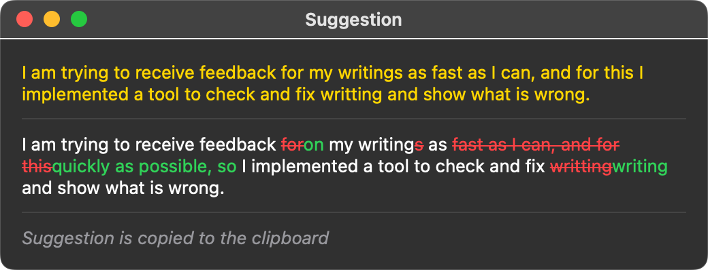
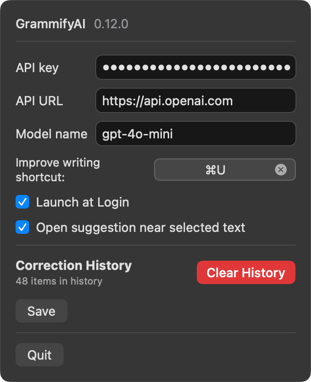
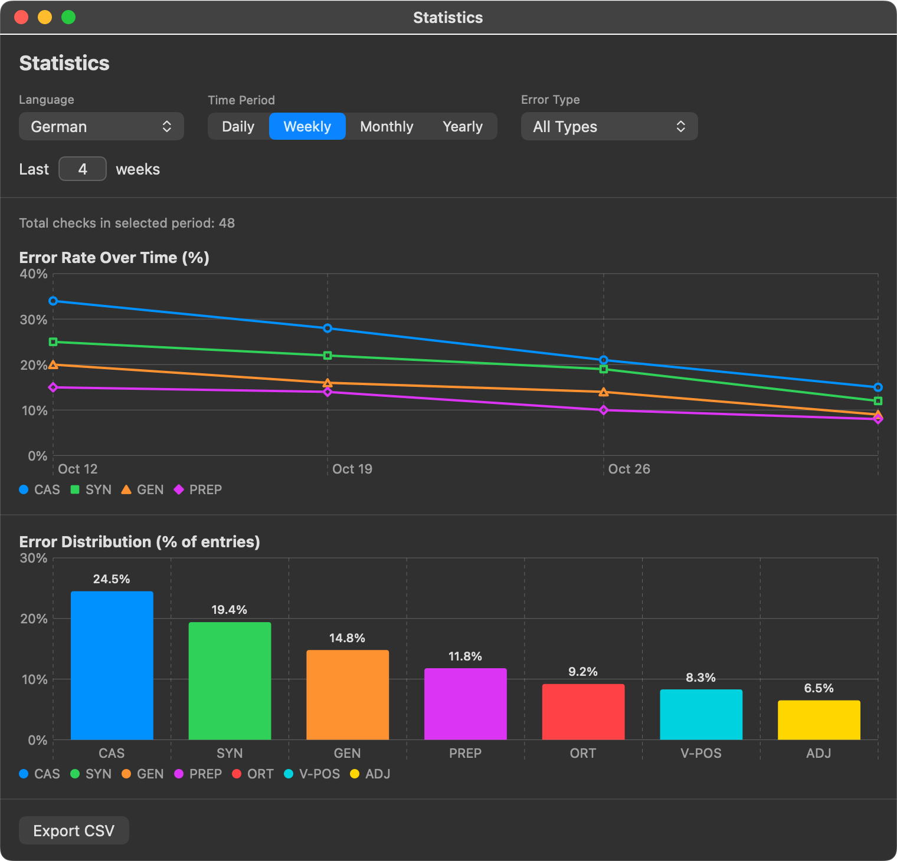

# GrammifyAI

**Minimalist LLM Grammar Checker for macOS that works with any application and language.**

Using GrammifyAI is as simple as selecting text and pressing a shortcut (`⌘ + U` or custom).
This triggers a popup with improvement suggestions and automatically copies the corrected text to your clipboard.

Thanks to the macOS Accessibility API, GrammifyAI works with text in any **web** or **native** application.
By leveraging **LLM integration** (e.g., OpenAI or any OpenAI-compatible provider), it not only fixes grammar and typos but also improves your phrasing and helps you track recurring mistakes over time.




GrammifyAI utilizes your own LLM API key. There are no quotas or limits from the GrammifyAI side; usage depends entirely on your LLM API billing.

## Features

* **System-Wide Shortcut:** Trigger corrections anywhere with `⌘ + U` (or set your own shortcut in Settings).
* **Visual Diff & Auto-Copy:** See exact word-level additions and deletions color-coded in a diff view alongside detected error category badges (hover to inspect specific fragments), with the corrected text automatically copied to your clipboard.
* **Floating Popup Near Selection:** Optionally open a compact, auto-sized suggestion popup right next to your selected text instead of a centered window.
* **Writing Statistics & Error Classification:** Automatically detects the language of your text, categorizes mistakes (Syntax, Vocabulary, Prepositions, Idiomatics, Register, Orthography, plus language-specific categories for **German** and **English**), and charts your error trends over time with CSV export.
* **OpenAI-Compatible API Support:** Defaults to OpenAI (`https://api.openai.com` with `gpt-4o-mini`), or point it to any OpenAI-compatible endpoint (e.g., OpenRouter, Groq, Ollama, LM Studio).
* **Menu Bar Convenience:** Supports **Launch at Login** and built-in updates via **Check for Updates...**.



## Installation

> **Requirements:** macOS 14.5 (Sonoma) or later.

1.  Download the latest [release](https://github.com/harentius/GrammifyAI/releases) and move it to your **Applications** folder.
2.  Right-click the GrammifyAI app and select "Open" to bypass the initial security check. Grant permission to open it if prompted.
    * *Note:* If the app is blocked, go to **System Settings > Privacy & Security** and allow the app to open.
      
3.  Grant Accessibility permissions: On first launch, macOS will automatically prompt you to grant Accessibility access. Click **Open System Settings** in the prompt (or use the **Grant Permission** button in the menu bar popover) and toggle **GrammifyAI** on in **System Settings > Privacy & Security > Accessibility**.  
    
4.  Open **Settings** in the GrammifyAI menu bar popover:
    * Enter your **API key**.
    * *(Optional)* Customize the **API URL** (default: `https://api.openai.com`), **Model name** (default: `gpt-4o-mini`), keyboard shortcut, **Launch at Login**, or **Open suggestion near selected text**.

## Updating the App
1.  Click the GrammifyAI menu bar icon and select **Check for Updates...** to install updates in-app, or download the latest release manually from GitHub.
2.  After installing a new version, GrammifyAI will automatically reset the outdated Accessibility permission entry and prompt you to toggle **GrammifyAI** back on in **System Settings > Privacy & Security > Accessibility** (no need to manually remove and re-add the app).
3.  If installing manually outside of in-app updates, you may need to repeat the "Right-click Open" step from the installation process.

## Usage
1.  Select the text you want to enhance.
2.  Press `⌘ + U` (or your custom shortcut).
3.  Review the suggested correction in the diff view.
    * *Tip:* Click the input field to regain focus if needed.
4.  Press `⌘ + V` to paste the corrected text.
5.  *(Optional)* Open **Statistics** from the menu bar to track your writing accuracy and most common error categories across languages over time, or export your history to CSV.

## Known Successful Use Cases
I use GrammifyAI daily in *Slack*, *Chrome*, *Notion*, *Messenger*, and standard web forms.

## Known Limitations
* Does not currently work in *Google Docs*.
* Since it uses an LLM, suggestions for sensitive or nuanced topics may occasionally alter the original meaning.

## Demo

https://github.com/user-attachments/assets/0ce6d724-68ee-4fa7-a468-54584888e801

## Building from Source

Open `GrammifyAI.xcodeproj` in Xcode and press `⌘ + R`, or build from the terminal:

```bash
xcodebuild -scheme GrammifyAI -configuration Release build
```

## Appendix

### 1. Motivation
I am currently learning German, which I find challenging. My thinking patterns differ from those of native speakers, and I wanted a way to receive immediate feedback on my writing without friction.

I built this tool to get quick, one-shortcut corrections without needing to engage in long conversations with ChatGPT or switch windows, and to track recurring grammar mistakes (such as German articles, cases, and verb positions) over time. While tools like Grammarly are great, they primarily support English, and their AI subscriptions can be expensive compared to using your own API key with modern LLMs.

### 2. Privacy & Security
Your API key is used **solely** to connect with the specified host (default: OpenAI) to provide functionality. It is not shared with anyone else.
* **API Key Storage:** Stored securely on your device using the macOS Keychain.
* **Correction History & Statistics:** Stored strictly locally on your Mac (`~/Library/Application Support/harentius.GrammifyAI/GrammifyAI.store`) and can be cleared at any time from **Settings > Clear History** or **Statistics > Clear History…**.
* Feel free to review the code and build the app yourself if you have any security concerns! ;)
